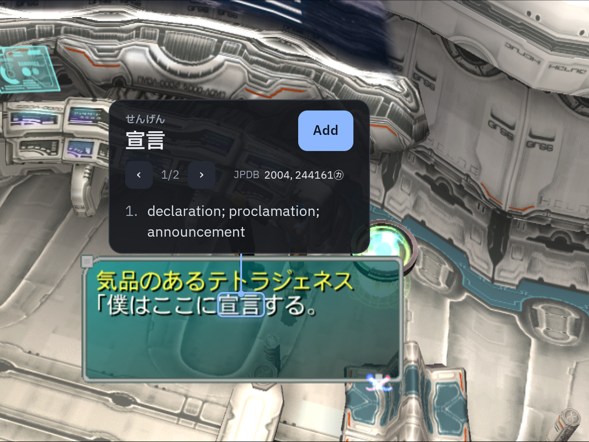
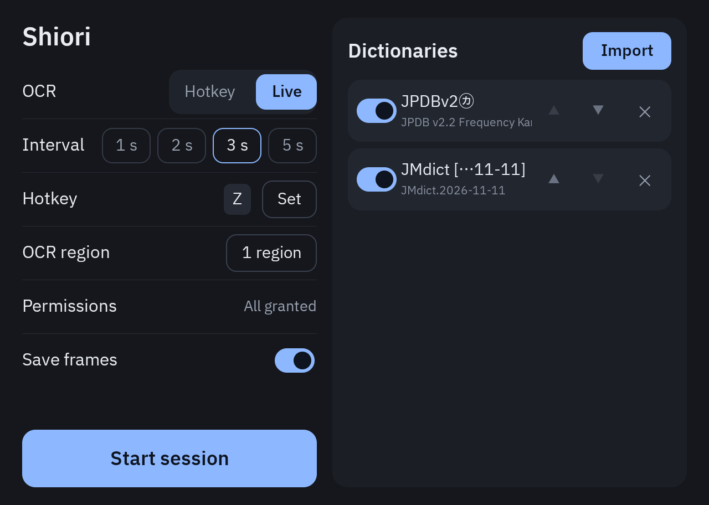
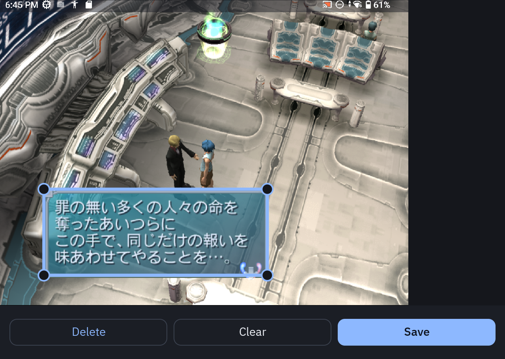
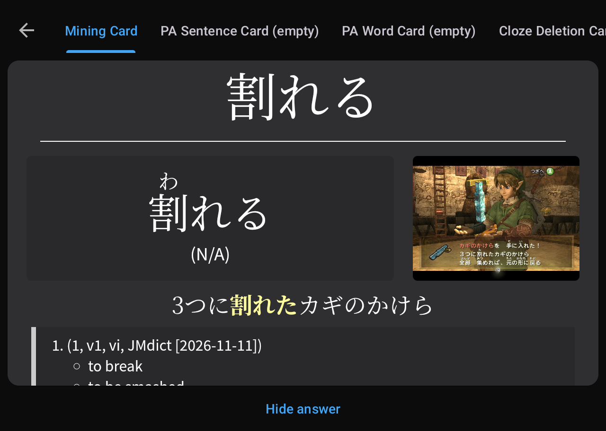

<h3 align="center">Shiori</h3>
<p align="center">Look up Japanese words in any game on your Android handheld with Anki integration.</p>

<p align="center">
  
  
</p>
<p align="center">
  
  
</p>

## Features

- Reads the text on screen while you play. The game is never paused or covered by a screenshot.
- Tap a word for its reading, meanings and frequency, with deinflection (食べなかった finds 食べる).
- One tap adds a card to AnkiDroid with the sentence and the game frame as the picture.
- Two ways to read:
  - **Hotkey**: press a controller button to read the screen once.
  - **Live**: reads your chosen regions every few seconds, so the words stay tappable as the dialogue moves on.
- Per-game OCR regions you draw, move and resize.
- Works with Yomitan dictionaries: term dictionaries such as Jitendex and JMdict, and frequency lists such as JPDB.
- OCR runs on the device (Meiki OCR, with ML Kit as fallback). Nothing leaves your device.

## Getting started

1. Install the APK and open Shiori.
2. Allow the accessibility service. It catches the hotkey and draws the tap layer and popup over your game.
3. Import your dictionary zips with **Import**.
4. Pick **Hotkey** or **Live**, then set a hotkey. For Live, set an OCR region on the game's dialogue box.
5. Press **Start session** and allow screen capture.
6. Open your game, press the hotkey (or wait for Live), and tap a word.

## Exporting to AnkiDroid

- Install AnkiDroid and allow Shiori access when asked.
- Cards use the JP Mining Note type and go to the Default deck.
- The button reads **In Anki** when the word already has a card, so you don't add it twice.

## Building

Needs JDK 17 (Android Studio's bundled JBR works) and the Android SDK.

```bash
./gradlew :app:testDebugUnitTest :app:assembleDebug
```

`scripts/install.ps1` builds, installs over the existing app and opens it.

## License

GPL-3.0. See [LICENSE](LICENSE). Bundled fonts, models and data are listed in [docs/third-party.md](docs/third-party.md).
